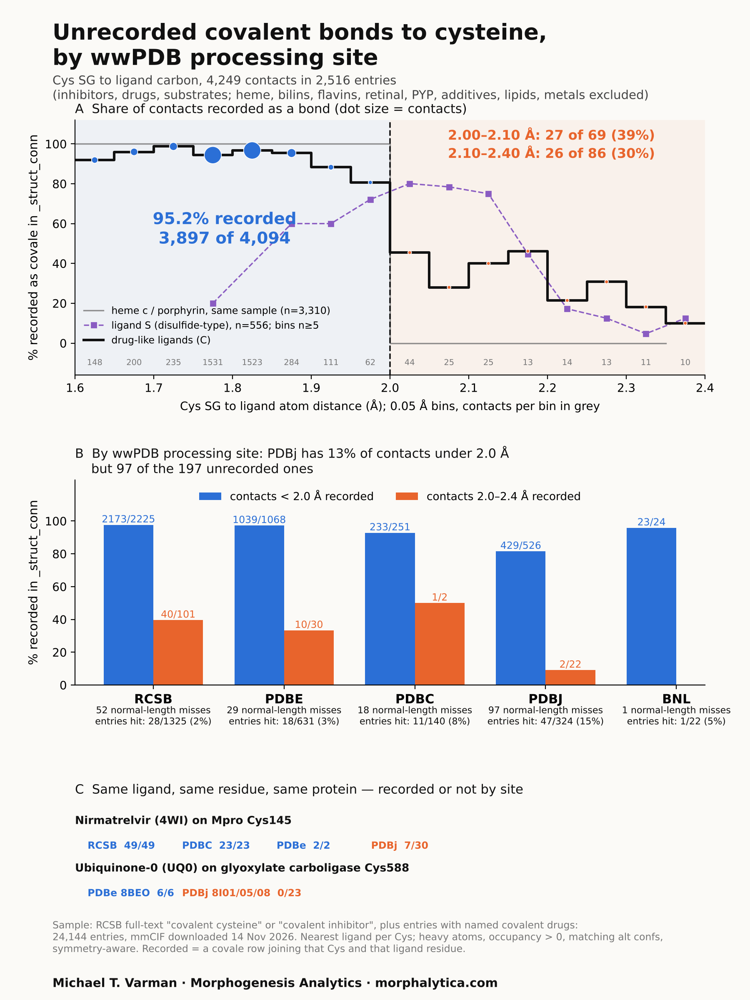

# Unrecorded covalent bonds to cysteine concentrate by wwPDB processing site

A scan of 24,144 PDB entries for cysteine–ligand contacts at covalent bond length, and whether `_struct_conn` records them. This is the ligand and drug counterpart of `../two-rulers/`, which measured the same two lines archive-wide on the validator side.

Full archive, with every contact table and `verify_counts.py`: **Zenodo DOI pending** (added here on publication).



## What it found

**The 2.0 Å record line is a step, not a cliff, once drugs and substrates are included.** Drug-like contacts (carbon partner, 4,249 contacts in 2,516 entries) are recorded 3,897 / 4,094 under 2.0 Å, 27 / 69 at 2.00–2.10 Å, 26 / 86 at 2.10–2.40 Å. Heme in the same sample is 3,019 / 3,019 under 2.0 Å and 0 / 291 at or above it. Part of the softening is legitimate: the 2.0–2.4 Å band holds near-attack and substrate complexes that are not bonds.

**The processing-site pattern is the firm one.** PDBj-processed entries hold 13% of the contacts under 2.0 Å and 97 of the 197 that carry no bond record.

| site | < 2.0 Å recorded | entries with ≥ 1 unrecorded contact |
|---|---|---|
| RCSB | 2,173 / 2,225 | 28 / 1,325 |
| PDBe | 1,039 / 1,068 | 18 / 631 |
| PDBc | 233 / 251 | 11 / 140 |
| **PDBj** | **429 / 526** | **47 / 324** |
| BNL | 23 / 24 | 1 / 22 |

Not a legacy effect: PDBj's unrecorded contacts are concentrated in 2021–2023 depositions, while other sites' are mostly 2006–2013. Not a clustering artefact either: they span 31 distinct ligand components in 47 entries, and dropping the two largest component groups leaves PDBj at 422 / 473 against 3,388 / 3,488 elsewhere.

**Two matched cases**, chemistry held fixed:

- **Nirmatrelvir (4WI) on Mpro Cys145** — RCSB 49/49, PDBc 23/23, PDBe 2/2, **PDBj 7/30**. The 23 unrecorded contacts are at 1.761–1.846 Å.
- **Ubiquinone-0 (UQ0) on glyoxylate carboligase Cys588** — 8BEO (PDBe, 2022) 6/6 at 1.664–1.718 Å; 8I01, 8I05, 8I08 (PDBj, 2023) 0/23 at 1.765–1.776 Å. The three PDBj entries carry no `covale` rows at all.

**The misses carry a refinement link restraint.** 55 of the 97 unrecorded PDBj contacts sit within one sigma of 1.766 Å — the generic carbon–sulfur automatic-link value cctbx applies at default settings, reproduced on seven builds in the heme c note — against 2 of 52 at RCSB. In the ubiquinone case, 21 of the 23 unrecorded contacts are on the value and 0 of the 6 recorded ones are. In 30 of the 105 entries with an unrecorded contact, every such contact sits there. A contact on that value is consistent with the pair having been restrained as a bond in refinement while the deposited file records nothing; this scan did not read refinement-software metadata, so that inference rests on the by-program split measured in the heme c note, not here.

## Files

```
cys_covalent_two_rulers.png    the figure above
tables/
  unrecorded_under_2.0A_druglike.tsv   the 197 normal-length contacts with no covale record (23 cols)
  druglike_2.0-2.4A_contacts.tsv       the 155 contacts in the long band
  named_drug_contacts.tsv              every named covalent-drug contact, per contact
  site_druglike.tsv                    per-site contact counts
  site_entry_level_druglike.tsv        per-site entry counts
  bins_*_0.05A.tsv                     recorded fraction per 0.05 Å bin: drug-like, heme, bilin
  drug_comps.tsv                       the 19 named covalent-drug components
  summary_numbers.txt                  every headline number, as printed by 06_analyze.py
scripts/                               01_candidates -> 08_export, the scan and analysis chain
```

`scripts/verify_counts.py` recomputes all 111 headline numbers from the shipped tables using the standard library alone. It expects the full `out/` directory, so run it from the root of the Zenodo archive, not from this repository.

The bulk scan output — every contact within 2.6 Å (`contacts_all.tsv`), the per-entry scan log, and the download log with a SHA-256 per mmCIF — is in the Zenodo archive.

## Method

Model 1 only, hydrogens removed, occupancy > 0 on both atoms, alternate conformers must match or be absent, distances symmetry-aware via gemmi `NeighborSearch` and the nearest periodic image. A ligand is a non-polymer residue that is not water and has more than one heavy atom; metal atoms are never contact atoms. Recorded means a `_struct_conn` row whose `conn_type_id` begins with `covale` joins that cysteine to that ligand residue, in either partner order, under any symmetry operator.

Candidates: RCSB full-text "covalent cysteine" (12,563) ∪ "covalent inhibitor" (16,281) ∪ entries containing one of 19 named covalent-drug components = 24,144 entries, all downloaded 14 Nov 2026. This is a sample, not the whole PDB; entries were chosen by text and component, never by `_struct_conn` content.

131 of the 197 unrecorded contacts are already in `../strict-cut-491/` (flag `in_strict_cut_491`). New here: the recorded-fraction curve for drug-like ligands, the processing-site breakdown, the two matched cases, and the link-value fingerprint.
